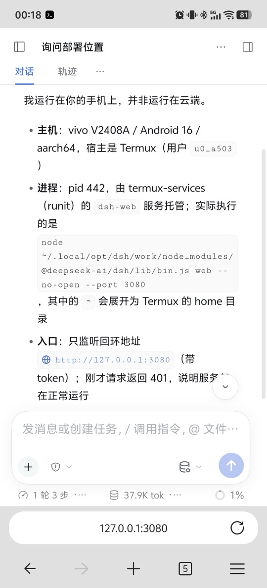

# termux-dsh-native

Run DeepSeek Harness (`dsh`) natively in Termux with minimal patches: no proot, no Linux subsystem, no custom Node build, no libc replacement. Two versioned patches, one `LD_PRELOAD` shim, and a few Node/pnpm helpers are all it takes.

Verified with `@deepseek-ai/dsh@0.2.2-rc.5` on Android 16 / aarch64.



## How it works

- **Link shim** (`dist/libdsh-termux-native-link.so`). Android rejects `link()` in app-private storage with `EACCES`. The shim turns it into copy → `fsync` → `renameat2(RENAME_NOREPLACE)`, preserving dsh's atomic publishes, and unsets `LD_PRELOAD` for child processes.
- **Wrapper** (`bin/dsh-wrapper.sh`). Sets `TMPDIR`, exports the optional fixed token, loads the shim, and execs the patched Node.
- **Two versioned patches** (`rewrites/sets/`): one required, one optional.
  1. `syncDirectory()` treats the first unreadable ancestor as the durability boundary; without it every attachment fails on Android.
  2. `processLaunchToken()` prefers `DSH_WEB_TOKEN`, keeping the web URL stable.

  A set applies only to the dsh versions it declares and stops on anchor drift.

## Requirements and limitations

- **Termux on Android, aarch64 only.** The shim is an aarch64 glibc object for Termux's glibc runtime; other apps and non-Termux environments cannot load it.
- **Termux glibc 2.44** (`glibc-repo`, `glibc`, `gcc-libs-glibc` — the last supplies the `libstdc++.so.6`/`libgcc_s.so.1` that Node links against). Node is the official linux-arm64 build with only its ELF interpreter patched.
- **No toolchain on the device.** The shim ships prebuilt in `dist/`; `binutils` is only needed to rebuild it (see [Rebuilding the link shim](#rebuilding-the-link-shim)).
- **No Landlock.** dsh's `workspace-write` sandbox fails closed, so the install pins `DSH_PERMISSION_MODE=danger-full-access`. dsh's file fence is off; the Android app sandbox (Termux UID) is the real boundary.
- **You open the browser.** The launch path is untouched: `dsh web --no-open`, then visit the token URL. Cookies keep upstream `SameSite=Strict`, which is correct for address-bar visits.
- **No `node` on the agent PATH.** dsh's PATH does not include `$DSH_ROOT/node/bin`, so the agent's bash tool cannot run `node` by name. Use the absolute path, or add a `node` wrapper and PATH entry if you need it.
- **Only supported dsh versions.** Versions not covered by a rewrite set are refused before anything changes.
- **~3 GB free space** and network for the first `npm install` (~1.2 GB dependency tree).

## Install

### Prerequisites

```sh
pkg install -y glibc-repo glibc gcc-libs-glibc termux-services termux-tools coreutils curl tar xz-utils patchelf
```

The git-clone route also needs `pkg install -y git`.

The installer checks for these packages and the commands it needs, and prints the exact `pkg install` line when something is missing; it never changes system packages itself. `termux-tools` ships with Termux and provides `termux-open-url` for the BROWSER helper.

`glibc-runner` is **not** required: it only adds `grun` and glibc builds of the usual CLI tools, at the cost of ~50 `-glibc` packages (~228 MB). Without it, use `pkg install -y binutils` for `readelf`/`objdump`; `ldd` comes with the `glibc` package.

### From a GitHub release

```sh
tmp="${TMPDIR:-$PREFIX/tmp}/termux-dsh-install.sh"
curl -fsSL https://github.com/mashago/termux-dsh-native/releases/latest/download/install.sh \
  -o "$tmp" && bash "$tmp" -y
```

Download-then-run matters: `curl … | bash` still exits 0 when the download fails, because bash receives an empty script.

### From a git clone

```sh
git clone https://github.com/mashago/termux-dsh-native
cd termux-dsh-native
bash install.sh -y
```

Both routes run the same installer: verify prerequisites, install or pin Node and dsh, deploy the runtime, apply the matching rewrites, verify, and start `dsh-web`. Flags: `--dsh-version <v>`, `--release <tag>`, `--repo <owner/repo>`, `--root <path>`, `--no-start`, `--check`, `--uninstall`.

Open the printed URL after install (or use the service commands below). The first visit trades the token for a 30-day cookie; afterwards `http://127.0.0.1:3080/` works directly.

## Running the service

```sh
./start_dsh.sh status     # service state, HTTP port, auto-start, URL
./start_dsh.sh start      # start and enable auto-start on Termux login
./start_dsh.sh stop       # stop and disable auto-start
./start_dsh.sh restart
```

The installer also drops a copy at `~/start_dsh.sh` for release installs. Both resolve every path from `$HOME`/`$PREFIX`, so either form works from any directory.

`dsh-web` is managed by termux-services. It does not return after a phone reboot unless Termux:Boot is installed; opening a Termux login shell starts it. A `paused` service is resumed by `start`/`restart` — see [Troubleshooting](#troubleshooting-paused-service).

## Upgrade and rollback

### From a GitHub release

```sh
tmp="${TMPDIR:-$PREFIX/tmp}/termux-dsh-update.sh"
curl -fsSL https://github.com/mashago/termux-dsh-native/releases/latest/download/update.sh \
  -o "$tmp" && bash "$tmp" -y
```

### From a git clone

```sh
git pull
bash update.sh 0.2.2-rc.5 -y    # pin a version; omit it to use the release's tested version
bash update.sh --check          # installed vs. supported versions
bash update.sh --rollback -y    # restore the previous version from install-state.json
```

The updater validates the target against the packaged rewrite sets before stopping anything, then backs up runtime files, upgrades Node when required, reinstalls dsh, reapplies rewrites, verifies, and restores the previous service state; failures roll back. A profile whose `node_modules` came from pnpm 9 needs a one-time rebuild first — see [Plugin management](#plugin-management). Other flags: `--backup-home`, `--no-restart`, `--force`, `--release <tag>`, `--repo <owner/repo>`, `--root <path>`, `--dsh-version <v>`.

## Plugin management

The installer deploys two helpers so the web UI and `dsh plugin` can install plugins through pnpm:

- `~/.local/bin/pnpm` runs **pnpm 11.28.5** through Corepack; pnpm 9 rejects `pnpm add` in dsh's profile workspace. Override the pin with `DSH_PNPM_VERSION`.
- `$DSH_ROOT/bin/npm` is a shim for Node's bundled npm, because Android has no `/usr/bin/env` for its shebang.

The `dsh` wrapper puts `~/.local/bin` on `PATH` (the installer also adds it to `~/.bashrc` and the service script), so `dsh plugin` works from non-interactive shells.

If Corepack must download pnpm, it uses npm's default registry; set `COREPACK_NPM_REGISTRY=https://registry.npmmirror.com` for the mainland mirror.

A profile whose `node_modules` was created by pnpm 9 must be rebuilt once before pnpm 11 can manage it (`ERR_PNPM_PUBLIC_HOIST_PATTERN_DIFF`):

```sh
P="$HOME/.dsh/profiles/web"
SVDIR="$PREFIX/var/service" sv down dsh-web
cp -p "$P/package.json" "$P/package.json.bak-pnpm11"
cp -p "$P/pnpm-lock.yaml" "$P/pnpm-lock.yaml.bak-pnpm11"
mv "$P/node_modules" "$P/node_modules.bak-pnpm9"
( cd "$P" && pnpm install )
SVDIR="$PREFIX/var/service" sv up dsh-web
```

After that, install and update plugins from the web UI or with `dsh plugin`. Verified with `dsh-plugin-release-probe@0.0.8` through `registry.npmmirror.com`.

## Layout

```
install.sh / update.sh        release/clone bootstraps
install-core.sh               install / update / rollback / check / uninstall
make-release.sh               build the release payload and SHA256SUMS
dist/                         prebuilt link shim
shim/                         link() interposer source, Makefile, device spike
rewrites/
  apply-rewrites.{sh,mjs}     version -> rewrite set dispatcher
  lib/common.mjs              backups, atomic writes, syntax checks, markers
  sets/<set>/                 manifest.json + index.mjs
bin/                          dsh wrapper, BROWSER opener, npm shim, pnpm wrapper
helpers.list                  helper source -> runtime destination map
start_dsh.sh / start_sshd.sh  service management and sshd startup
verify-install.sh             post-install checks
smoke-web.sh                  dsh web startup/HTTP smoke test
```

Runtime (`~/.local/opt/dsh`): `node/`, `work/` (npm prefix), `lib/` (link shim), `bin/` (dsh, dsh-open, npm), `tools/` (rewrites + `helpers.list`), `etc/web-token`, `backups/`, plus `rewrites-state.json`, `install-state.json`. `~/.local/bin` holds `dsh` and `pnpm`. dsh data lives in `~/.dsh`.

## Notes

- Token: `~/.local/opt/dsh/etc/web-token` (mode 600). Replace it and restart `dsh-web` to rotate; cookies last 30 days.
- Plugin helpers are project-managed: edit `bin/*-wrapper.sh` or `helpers.list` in the project, not the deployed copies. Install and update overwrite them.
- Back up `~/.dsh` (minus `cache`) before upgrades; `update.sh --backup-home` does that for you.
- Never run `npm install` without `--ignore-scripts`; koffi tries to compile.

## Development

- New dsh version: see `rewrites/README.md`; a compatible version needs only `{"versions":["<v>"],"extends":"<existing-set>"}`.
- Release: `./make-release.sh --project v0.3.0 --tested-dsh 0.2.2-rc.5`, then attach `release/*` to a GitHub release.
- In the wrapper, bionic commands must run before `LD_PRELOAD` is set.

### Rebuilding the link shim

The shim is the only native artifact and `dist/libdsh-termux-native-link.so` is committed, so installing and running dsh never builds it: no compiler, no `binutils` on the device. Only a rebuild needs `pkg install -y binutils` on the phone — and only the phone can link, because the macOS host has no aarch64 ELF linker. The object compiles on the Mac, the linking happens in Termux.

**On the Mac** (cross-compile the object):

```sh
cd shim
make fetch-sysroot   # pulls $PREFIX/glibc/include from the device -> ../.build-sysroot
make                 # clang --target=aarch64-linux-gnu -c -> link_shim.o
```

`fetch-sysroot` and `device-link` drive `ssh`/`scp` through `sshpass` (`SSHPASS_FILE`, default `~/.ssh/masha_iqoo_sshpass.txt`); override `DEVICE=` to target another phone.

**On the device** — `binutils` is needed here, and only here (once):

```sh
pkg install -y binutils     # provides ld.bfd and gstrip
make device-link            # scp link_shim.o over, link with ld.bfd, strip debug info
```

`device-link` resolves the linker as `$LD` → `ld` on `PATH` → `$PREFIX/bin/ld.bfd` (bionic binutils) → `$PREFIX/glibc/bin/ld` (only present while `glibc-runner` is installed), and fails with a `pkg install -y binutils` hint when none exists. It writes `~/.dsh-termux-native-build/libdsh-termux-native-link.so` and leaves the `.o` next to it.

**Back on the Mac** (publish the artifact):

```sh
scp masha_iqoo:~/.dsh-termux-native-build/libdsh-termux-native-link.so dist/
```

That file is what `install.sh` deploys to `$DSH_ROOT/lib/` and what `make-release.sh` ships, so a rebuilt shim reaches users through the normal install/update path. Every step is idempotent; `make clean` plus removing `../.build-sysroot` starts over.

## Uninstall

```sh
bash install.sh --uninstall               # keeps ~/.dsh
bash install.sh --uninstall --purge-home  # also deletes sessions and credentials
```

## Troubleshooting: paused service

If the web UI stops responding and `./start_dsh.sh status` reports `paused`, the dsh process was stopped by `SIGSTOP`; runit marks it paused. This is not a crash. Android/OEM battery management can freeze background processes.

```sh
./start_dsh.sh start        # detects paused and runs sv cont
./start_dsh.sh restart      # also handles a paused service
SVDIR=$PREFIX/var/service sv cont dsh-web   # direct resume
```

After resuming, refresh the web UI. A bare `http://127.0.0.1:3080/` returns 401 until the browser has the token cookie; use the token URL printed by `./start_dsh.sh status`.

To reduce recurrence, give Termux unrestricted battery/background use in Android settings (that covers OEM "background freeze" and battery-saver app management) and hold a wake lock with `termux-wake-lock`.

## License

MIT
